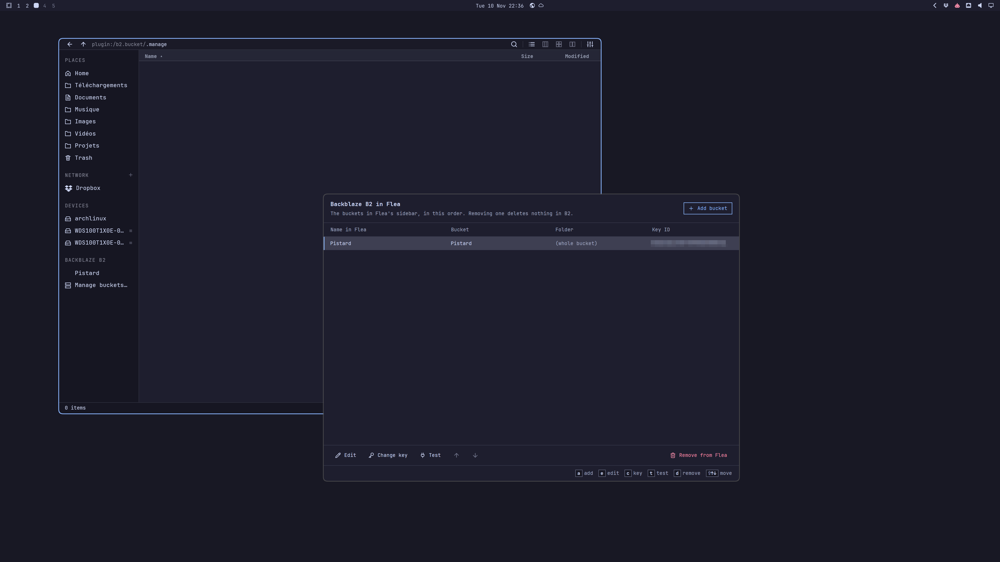

<a id="readme-top"></a>

<div align="center">

<pre>
─────────────────────────────
   F  L  E  A    ·    B  2

</pre>

# ☁️ Backblaze B2 for Flea


A plugin for the [Flea](https://github.com/thisisgm/flea) file manager. It lists your Backblaze B2 buckets<br/>
in the sidebar, so you can browse them and drag files in and out like any other folder.

<br/>



<br/>

✨ [What it does](#-what-it-does) • ⚡ [Installation](#-installation) • 🚀 [Getting started](#-getting-started) • 💡 [Good to know](#-good-to-know) • 🎨 [Made for Omarchy](#-made-for-omarchy) • 💛 [Thanks](#-thanks) • 🔧 [For developers](#-for-developers)

</div>

---

## ✨ What it does

- ☁️ Each bucket gets its own row in Flea's sidebar.
- 🔁 Copying, moving and renaming inside B2 happens on Backblaze's side, so nothing is
  downloaded. That also works between two buckets, as long as they use the same key.
- 🗑️ Deleting a file only hides it, which is how B2 does deletes. The older versions stay until
  your bucket's lifecycle rules clean them up.
- 📦 Big files are uploaded in parts and checked with SHA-1. Modification times are kept in both
  directions, the same way `b2` and `rclone` keep them.
- ⏳ A long transfer doesn't block Flea. It carries on in the background, even if you close
  Flea, and you get a notification at the end.
- 🪟 A small window, **Manage buckets…**, is where you add, rename, reorder and remove buckets.
  You can do all of it from the keyboard.
- 🔐 Your application keys go in your system keyring. They're never written to a file.

<div align="right"><a href="#readme-top">↑ back to top</a></div>

---

## ⚡ Installation

You need [Flea](https://github.com/thisisgm/flea) 0.4.0 or later. Flea doesn't compile plugins,
so you build this one yourself. On Arch Linux and Omarchy:

```bash
sudo pacman -S --needed base-devel rust libxcb libxkbcommon libxkbcommon-x11 wayland vulkan-icd-loader fontconfig
git clone https://github.com/314r/flea-plugin-b2.git
cd flea-plugin-b2
make
make install
```

`make` takes a few minutes the first time. `make install` then adds the plugin to Flea and turns
it on, and **Backblaze B2** shows up in the sidebar.

If you'd rather not build it, the
[releases page](https://github.com/314r/flea-plugin-b2/releases) has a ready-made archive for
x86_64 Arch and Omarchy, with the commands to install it.

On another distribution you need Rust 1.98 or later, a C compiler, and the libraries above under
whatever names your distribution gives them. If your Rust is too old, `mise exec -- make` uses
the version pinned in `mise.toml`.

Two more things have to be running, and on most desktops they already are: a keyring that speaks
the Secret Service API (gnome-keyring, KeePassXC…) and a systemd user session.

To update later, `git pull` and then `make update`. Flea keeps its own copy of the plugin, so
pulling alone changes nothing.

<div align="right"><a href="#readme-top">↑ back to top</a></div>

---

## 🚀 Getting started

1. Create an application key on Backblaze's
   [App Keys page](https://secure.backblaze.com/app_keys.htm). Give it read and write access to
   the buckets you want to see in Flea.
2. In Flea's sidebar, click **Manage buckets…** under **Backblaze B2**. A window opens.
3. Press `a`, paste the key ID and the key, and pick a bucket from the list. You can rename it,
   and point it at a folder inside the bucket if you don't want the whole thing.
4. Go back to Flea. The bucket appears in the sidebar within about ten seconds, and you can
   start dragging files into it.

One oddity: when you click **Manage buckets…**, Flea itself shows an empty folder, because for
Flea that row is just another place. Go back, or click something else. Clicking the row again
brings the window to the front.


<div align="right"><a href="#readme-top">↑ back to top</a></div>

---

## 💡 Good to know

**Where do my keys go?**
Into your keyring, once per key ID. Several buckets can share a key, and when you remove the last
bucket that uses one, the key leaves the keyring as well. The list of buckets is a plain file,
`~/.config/flea-b2/buckets.json`. It holds names, folders and key IDs, and no secrets.

**Is a deleted file really gone?**
No. It disappears from the listing, but B2 keeps the older versions. With the default
"keep all versions" setting you can still restore it from the Backblaze web console.

**Can it overwrite my files?**
No. If the name already exists where you're copying to, the plugin refuses before it transfers
anything.

**Flea said "done" but my upload is still going.**
Flea only waits 30 seconds for a plugin. After about 24 seconds, the plugin tells Flea it's done
and keeps working in the background. A notification tells you when the transfer has finished, or
why it failed. Refresh the folder to see the new files. Flea can't cancel a transfer; if you need
to stop one, run `pkill -f 'flea-b2 worker'`.

**Why can't I copy between these two buckets?**
They use different keys, and a copy inside B2 needs one key that can reach both buckets. Copy
through a local folder instead.

**What's missing?**
Flea draws everything inside a plugin's folders, and there it has no New Folder, Trash, Duplicate
or Undo, and it can't open a file in place. To open a file, copy it to your disk first. The
bucket rows themselves can't be renamed or deleted from Flea; do that in the window. A folder
with more than 256 items shows the first 256 and a last row saying there are more. And Flea draws
at most 64 rows per plugin, so you can have 63 buckets.

**Something isn't working. Where do I look?**
The plugin writes a log to `~/.local/state/flea-b2/plugin.log`. If your keyring is locked, you'll
get its unlock prompt; if you miss it, the folder says "The keyring is locked" and a refresh
tries again. If `buckets.json` gets damaged, the sidebar keeps only **Manage buckets…**, and the
window tells you what's wrong with the file.

<div align="right"><a href="#readme-top">↑ back to top</a></div>

---

## 🎨 Made for Omarchy

The window is built with [gpui-omarchy](https://github.com/huacnlee/gpui-omarchy), so it looks
like the rest of your desktop. It uses your current theme's colors, your monospace font, your
text size and your window transparency, and it repaints a moment after you change any of them.
There's nothing to restart.

It runs outside Omarchy too. There it uses the Tokyo Night colors and whatever monospace font
fontconfig gives it.

<div align="right"><a href="#readme-top">↑ back to top</a></div>

---

## 💛 Thanks


- **[Flea](https://github.com/thisisgm/flea)** by GM is the file manager it lives in, and Flea
  draws nearly everything you see. The script that writes
  [THIRD-PARTY-LICENSES.txt](THIRD-PARTY-LICENSES.txt) is adapted from Flea's too.
- **[GPUI](https://www.gpui.rs)** by Zed Industries,
  **[gpui-kit](https://github.com/longbridge/gpui-kit)** by Longbridge and
  **[gpui-omarchy](https://github.com/huacnlee/gpui-omarchy)** by Jason Lee draw the window.
- **[Lucide](https://lucide.dev)** made the icons, and **[Omarchy](https://omarchy.org)** set
  the look.
- rustls, ring, ureq and zbus do the talking to B2, the keyring and the notifications.

This is an independent project. Backblaze and Flea's author didn't make it and don't support it,
so please report its bugs here. Backblaze and B2 are trademarks of Backblaze, Inc.

<div align="right"><a href="#readme-top">↑ back to top</a></div>

---

## 🔧 For developers

It's all Rust, in two binaries:

- `flea-b2` (in `src/`) is the plugin and its transfer worker. It speaks Flea's JSON-lines
  protocol on stdin and stdout, B2's native API over rustls, and D-Bus to the keyring and the
  notifications.
- `flea-b2-manager` (in `manager/`) is the window, built with GPUI on the plugin's own library.

```sh
make test          # unit tests, then protocol tests against a fake B2, then a license check
make keyring-test  # the real keyring code, against a throwaway keyring on a private D-Bus session
make licenses      # rewrite THIRD-PARTY-LICENSES.txt after Cargo.lock changes
make update        # reinstall into Flea after a change
```

The protocol tests in `tests/` need Python 3. They start `flea-b2` the way Flea does (own process
group, `LC_ALL=C`, 30-second limit) and check every listing against Flea's bounds.
`tests/fake_b2.py` is an in-memory B2 that can inject faults and delays. A build with
`--features test-hooks` takes the fake API URL, fake keys and a stand-in for `systemd-run` from
the environment; the release binaries have none of that.

A few choices that may look strange:

- **The window is a separate program, started through `systemd-run --user`.** Flea runs a plugin
  with a 512 MiB address-space limit that child processes inherit, which is too little for a
  GPU-drawn window, and it stops a plugin by killing its whole process group. Without systemd,
  start `~/.config/flea/plugins/b2.bucket/bin/flea-b2-manager` yourself.
- **Manage buckets… is a sidebar row** because Flea gives a plugin no other place to put it.
  Right-click actions only appear in local folders, and a plugin's Settings page only shows
  settings fields.
- **There's no "All buckets" row.** The manifest declares a place, since Flea only sends listings
  and file operations to a plugin that has one, but with an empty `path`, which hides its row.
- **Rename and move inside B2** are a server-side copy followed by a hide. B2 has no rename.
- **Empty folders** are kept with B2's usual `.bzEmpty` marker file, which the listing hides.
- **Build output goes to `.target/`.** `flea plugin add` skips dot folders, and Flea refuses a
  plugin folder over 64 MiB.

Flea's plugin manual is [PLUGINS.md](https://github.com/thisisgm/flea/blob/main/PLUGINS.md).

<div align="right"><a href="#readme-top">↑ back to top</a></div>

---

## 📜 License

[MIT](LICENSE). The binaries also contain the Rust crates listed in
[THIRD-PARTY-LICENSES.txt](THIRD-PARTY-LICENSES.txt), each with its own license and notices.
`manager/src/desktop.rs` adapts gpui-omarchy's theme watcher, and `tools/third-party-licenses`
adapts Flea's license script; both are MIT as well.

---

<div align="center">

☁️ 🪣 ☁️

### 💛 Carried by Flea, drawn with GPUI, and colored by your Omarchy theme.

</div>
